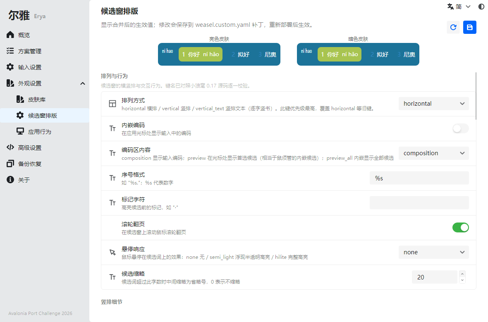
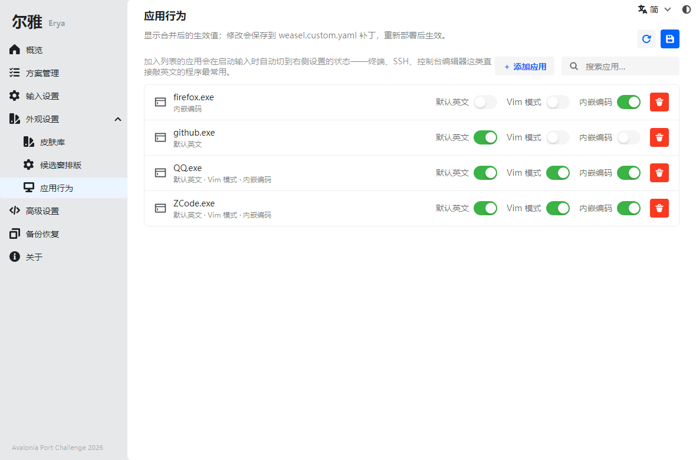
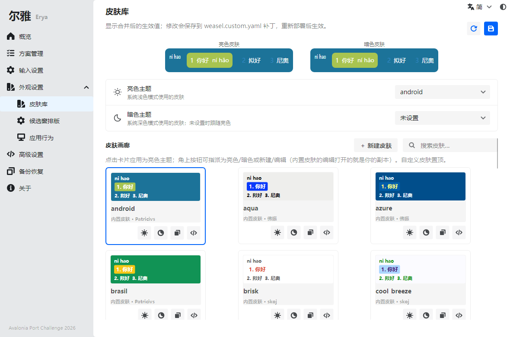
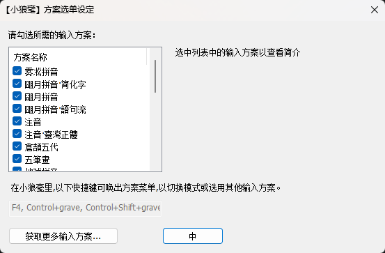
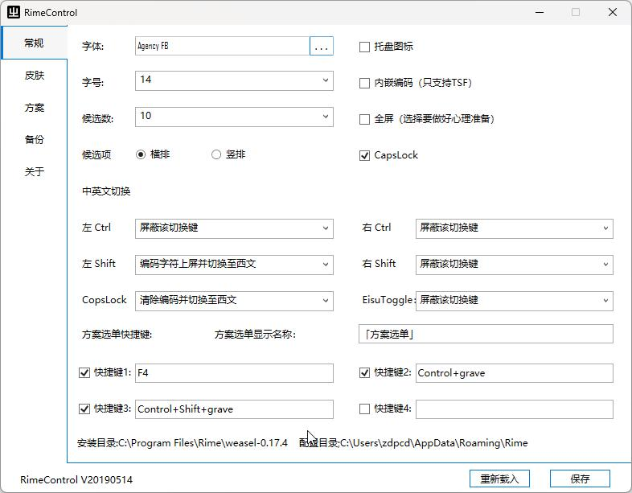
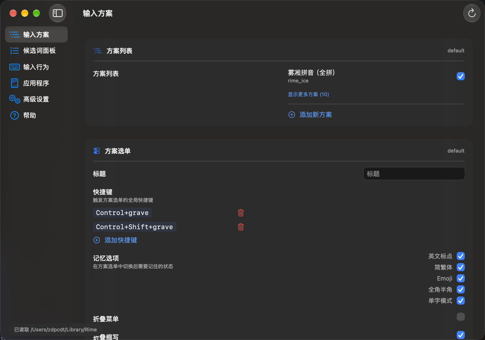
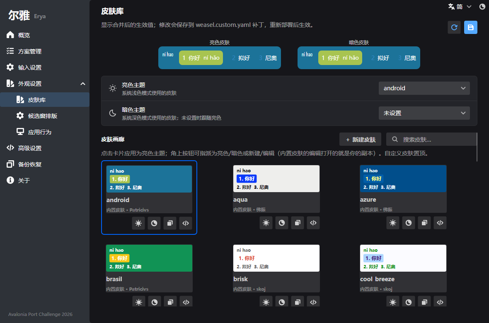

# Erya 尔雅

[简体中文](README.md) · **English**

   

**A visual configuration tool for the RIME input method engine** — tame RIME without ever touching YAML.

> *Er* means "to bring near"; *ya* means "the refined standard". The *Er Ya* is the oldest known Chinese dictionary — the name is a nod to "guiding speech toward the right sound".

One codebase, three desktop platforms, auto-detecting whichever RIME frontend is installed: **Weasel** (小狼毫) on Windows, **Squirrel** (鼠须管) on macOS, **fcitx5-rime / ibus-rime** on Linux. The UI ships in Simplified Chinese, Traditional Chinese and English.

| Overview | Schemas | Input | Layout | Apps |
|---|---|---|---|---|
|  |  |  |  |  |



> Every screenshot in this README is generated by a headless render test running against the machine's **real** RIME install (`DocsScreenshotGenerator` — Weasel on Windows, Squirrel on macOS; this gallery was captured on a real Squirrel setup). What you see is real data.

## The problem it solves

RIME is the most customizable Chinese input engine around — but all of that power lives in YAML: patch semantics, key paths, per-frontend key spellings. For a regular user the barrier is real, and one wrong key can silently do nothing… or make the candidate window disappear.

The tooling landscape mirrors it: on Windows the official GUI covers only basic toggles — everything beyond means hand-editing YAML — and third-party tools, each fine on its own, sit at opposite ends of the platform divide in separate tech stacks (Qt, WPF, native macOS; the Qt tool's port comparison is below). Linux never even got a GUI: the official config manager, plum (东风破), is a shell script, and the desktop panels' settings only cover the input-method framework itself — RIME schemas and patches still mean hand-edited YAML.

| Built-in GUI (Weasel · Windows) | RimeControl (WPF · Windows) | SCT (native macOS) |
|---|---|---|
|  |  |  |

Erya encodes that knowledge into the app itself:

- **What you see is what's in effect.** Every setting shows the merged base + patch value; saving writes exactly the keys you touched, and deleting a key from the patch restores the shipped default. Distribution files are never modified.
- **It can't write broken config.** Whole-key patch pitfalls (e.g. rewriting `preset_color_schemes` wholesale) are avoided by leaf-key patching; unmodeled keys are carried through verbatim; a write that no longer parses rolls back automatically.
- **Every exposed key is real.** Each key is verified against frontend sources (Weasel 0.17 / Squirrel / librime 1.16), and a whitelist test fails CI for any key that renders fine but the engine never reads — placebo controls don't ship.

## Features

**Schema management**

- Toggle schemas on/off, drag to reorder switching priority; saves to `default.custom.yaml` and auto-deploys
- One-click online installs (Rime Ice 雾凇拼音 / Baishuang 白霜拼音 / Bohe 薄荷拼音) straight from GitHub tarballs — automatic backup before install, auto-deploy after; installed packages uninstall precisely, by their own file manifest
- Text-level editing preserves your comments; a write that fails validation rolls back

**Input settings**

- Candidate count, schema menu, CN/EN toggle key matrix, function hotkeys (incl. first/last-character selection), digit punctuation — portable across all three frontends

**Appearance**

- **Skin library**: a `preset_color_schemes` editor with BGR color pickers and side-by-side light/dark live previews; built-in skins are read-only, forkable ("duplicate from this"), and exportable as YAML
- **Candidate-window layout**: fonts / spacing / corner radius / shadow / horizontal-vertical / size limits, with a live preview that reflects unsaved edits — one preview engine resolving both key spellings (`style/layout/*` for Weasel, `style/*` for Squirrel)
- **Per-app behavior**: default-ASCII and Vim mode per application; macOS enumerates running apps in the add dialog, Windows lists windowed processes

**Power tools & safety net**

- Advanced settings: base + patch merged tree, inline edit = instant patch write, per-key undo, path/value search; a source mode to edit `.custom.yaml` directly (YAML validation + `.bak` before saving)
- Backup & restore: one-click zip of the user directory; restore takes a safety backup first and auto-deploys afterwards
- Deployment: Ctrl+R / Cmd+R global redeploy; a frontend switcher when fcitx5-rime and ibus-rime coexist; distro-specific `librime` package hints when the deployer is missing

## Download

Grab a self-contained build from [Releases](https://github.com/zdpcdt/Erya/releases) (no .NET runtime required, built by CI):

| Platform | File | Notes |
|---|---|---|
| Windows x64 | `Erya_0.1.0_win_x64.zip` (also an `_aot` variant — smaller, faster startup) | unzip and run |
| macOS arm64 | `Erya_0.1.0_osx_arm64.zip` | unsigned/unnotarized: `xattr -cr` first |
| Linux x64 | `Erya_0.1.0_linux_x64.zip` | unzip and `./Erya`, or use a bundle below |

Linux also ships three bundle formats: `tar.gz` (user-level `install.sh`), `AppImage` (portable), `deb` (`sudo apt install`).

Detection and deployment have been verified on real hardware: macOS (arm64, Squirrel) and Ubuntu 26.04 (librime 1.16, fcitx5-rime/ibus-rime).

## Building from source

| Component | Choice |
|---|---|
| UI framework | Avalonia 12 / .NET 10 |
| Theme | [Semi.Avalonia](https://github.com/irihitech/Semi.Avalonia) + [Ursa](https://github.com/irihitech/Ursa.Avalonia) |
| MVVM | CommunityToolkit.Mvvm |
| YAML | YamlDotNet |

```bash
dotnet build Erya.slnx
dotnet run --project src/Erya
```

Packaging: `pwsh packaging/publish.ps1 -Rid win-x64 [-Aot]` produces `dist/Erya_<version>_<platform>[_aot].zip` (Native AOT cannot cross-compile, so each RID builds on its native OS); `packaging/linux/dist.sh` emits the three Linux bundles in one run. GitHub Actions runs the full test suite on all three OSes for every push/PR; packaging is a manual Run workflow, and filling in `release_tag` auto-publishes a GitHub Release with every artifact.

## How it works: making friends with patch semantics

All user modifications in RIME land in a `patch:` map inside `<file>.custom.yaml`, and **a patch key replaces, it does not merge**. Erya's read/write model follows from that:

1. **Display merged values, write only user-dirty keys** — every page reads base + patch merged, saves write exactly the touched keys, and unknown keys are carried through verbatim.
2. **Leaf-key patching** — editing a shipped skin goes through `preset_color_schemes/<id>/<field>`, merged into the official definition, so fields the editor doesn't model survive.
3. **Schema-driven UI** — settings pages are described by `Erya.Core/Settings/settings.*.json` (key path → control type → range); new RIME options are a JSON edit, not a code change.

The repo's 213 tests run headless on any OS: config roundtrips, schema whitelist validation, deploy-wait logic with injected clocks, and render tests that screenshot real pages — the README gallery is itself a test artifact, doubling as the visual acceptance gate.

## Porting Notes: Qt/QML → Avalonia

This is an entry for the **Avalonia Port Challenge 2026**, functionally modeled on three predecessor tools — [rimetool](https://github.com/yanhuacuo/rimetool) (Qt 6 / QML, Windows-only; the main feature reference), [RimeControl](https://github.com/qzly/RimeControl) (WPF; backup/restore flow) and [SCT](https://github.com/neolee/sct) (macOS; the two-layer config model and schema-driven settings pages) — and **sharing no code or assets with any of them**: a ground-up Avalonia 12 / .NET 10 implementation running the same source on Windows, Linux and macOS against whichever RIME frontend is installed.

**The full migration write-up is in [docs/porting-notes.md](docs/porting-notes.md)** — the parts a diff won't show: why RIME's patch semantics (not the UI) were the hard part, how one codebase serves three frontends with honest differences, concrete Qt→Avalonia mapping notes for fellow porters, testing as a first-class feature, and what went beyond the original.

### Before / after

| Feature | rimetool (Qt, before) | Erya (Avalonia, after) |
|---|---|---|
| Theming + preview |  |  |
| Layout |  |  |
| Dark theme |  |  |

> "Before" screenshots are of the original Qt rimetool, shown for functional comparison.

Same feature surface (colors / layout / misc / hotkeys / punctuation / schemas / backup), from a Windows-only Qt 6 app to one Avalonia codebase across Windows / Linux / macOS.

## Acknowledgements

- [RIME](https://rime.im) (by 佛振) and its frontends: Squirrel, Weasel, fcitx5-rime / ibus-rime
- [rimetool](https://github.com/yanhuacuo/rimetool) (the Qt tool whose feature set Erya is modeled on — no code shared), [SCT](https://github.com/neolee/sct) (inspiration for the two-layer config model), [RimeControl](https://github.com/qzly/RimeControl) (backup/restore approach)
- UI foundation: [Semi.Avalonia](https://github.com/irihitech/Semi.Avalonia) / [Ursa](https://github.com/irihitech/Ursa.Avalonia) / the Avalonia community

## License

MIT — see [LICENSE](LICENSE)
