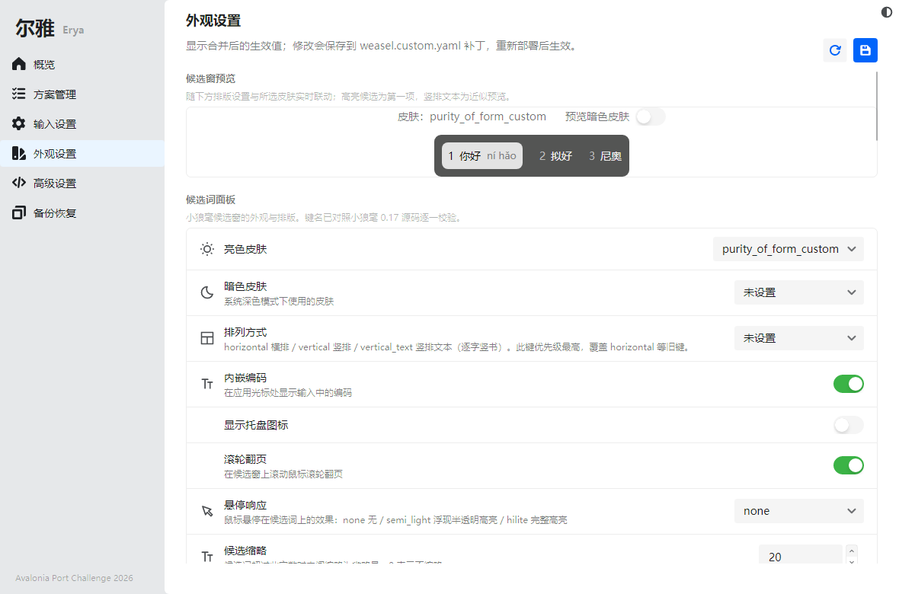
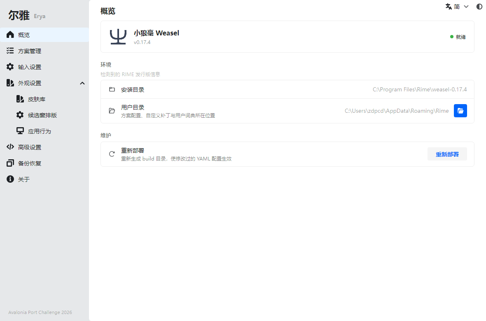
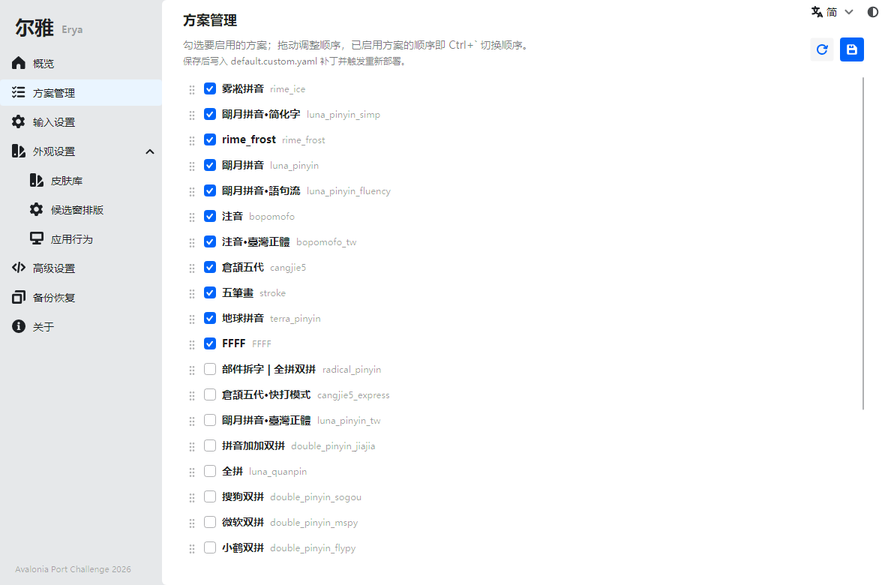
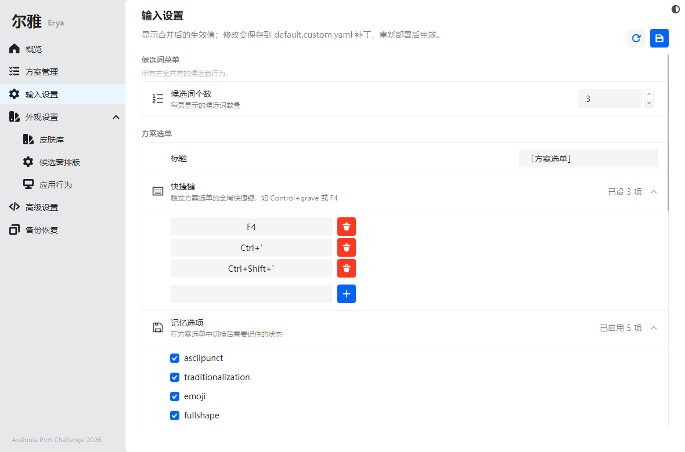
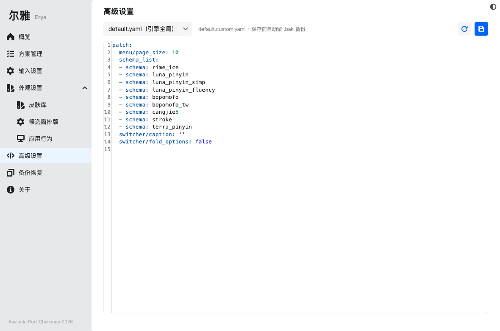
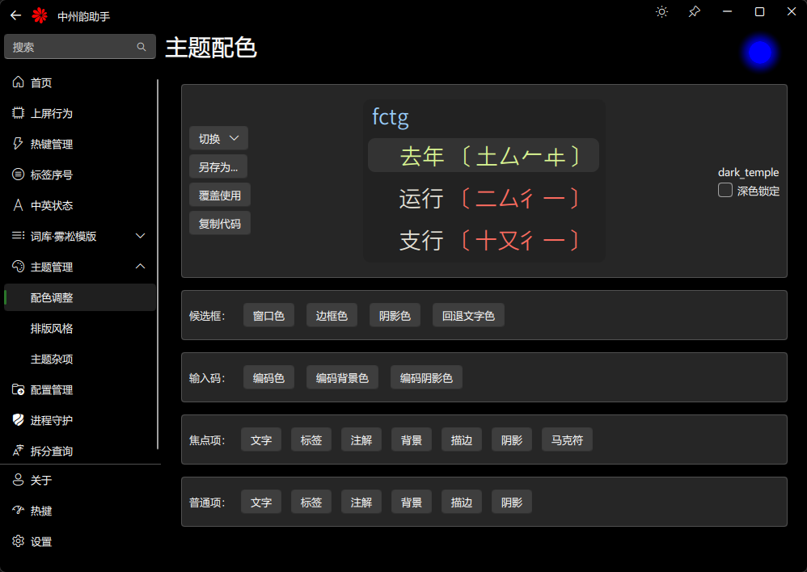
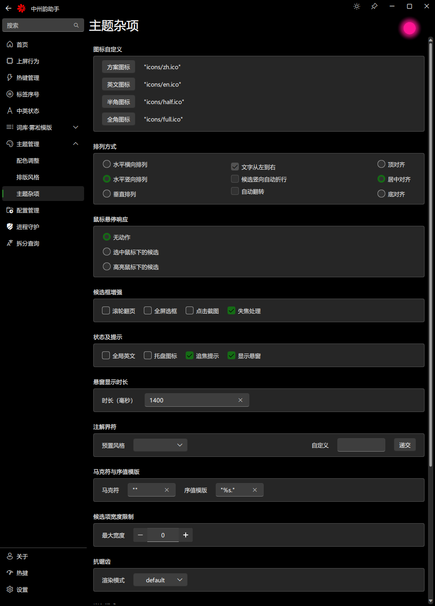
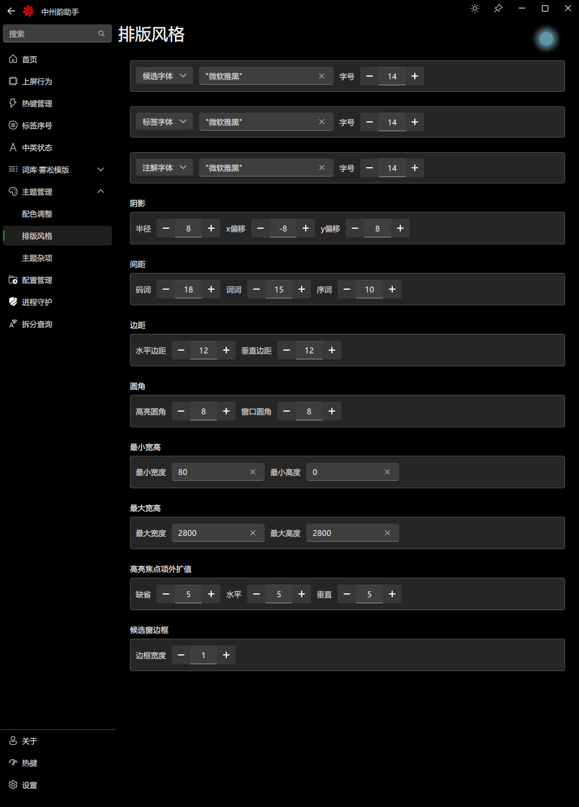
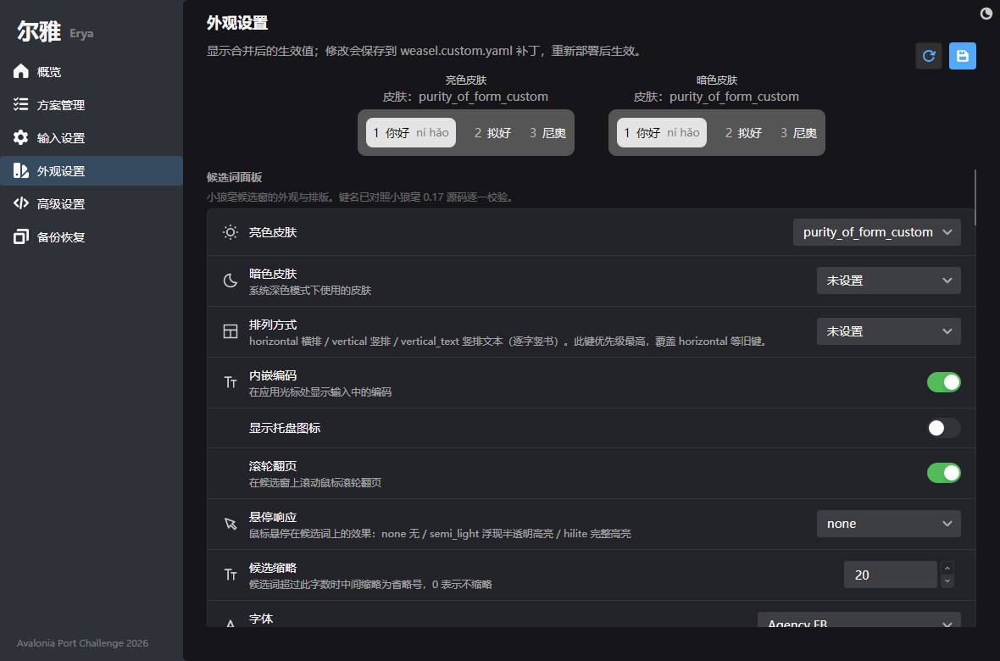

# 尔雅 Erya

**中州韵输入法引擎（RIME）的可视化配置工具** —— 让每个用户都能"近雅"：不写 YAML，也能把 RIME 调教得服服帖帖。

> 尔，近也；雅，雅言也。《尔雅》为辞书之祖，取"引向正音"之意。

基于 **Avalonia** 构建，一套代码覆盖 Windows（小狼毫 Weasel）、Linux（fcitx5-rime / ibus-rime）、macOS（鼠鬚管 Squirrel）。



| 概览 | 方案管理 | 输入设置 | 高级设置 |
|---|---|---|---|
|  |  |  |  |

> 截图由仓库里的无头渲染测试对着本机真实安装的小狼毫 0.17 生成（`DocsScreenshotGenerator`），所见即真实数据。

### 移植前后对照（Qt 版 rimetool → Avalonia 版尔雅）

| 功能 | Qt 版 rimetool（移植前） | 尔雅 Erya · Avalonia（移植后） |
|---|---|---|
| 主题配色 + 预览 |  |  |
| 排版风格 |  |  |
| 深色主题 |  |  |

同样的功能面（配色/排版/杂项/热键/标点/方案/备份），从 Windows 专用 Qt 6 应用变成一套代码跑 Windows / Linux / macOS 的 Avalonia 应用。

## 当前状态

🚧 项目启动于 2026-10（Avalonia Port Challenge 2026 参赛作品，移植自 Qt 版 [rimetool](https://github.com/yanhuacuo/rimetool) 的功能设计，并借鉴 WPF 版 [RimeControl](https://github.com/qzly/RimeControl) 的备份恢复思路；设置页架构参考 macOS 版 [SCT](https://github.com/neolee/sct) 的双层配置模型与 schema 驱动 UI）。

- [x] 发行版抽象层（`IRimeDistribution`）；Windows 小狼毫、Linux fcitx5-rime / ibus-rime、macOS 鼠须管的检测与部署（Ctrl+R / Cmd+R 全局重新部署）；概览页版本号在 Linux 上取自包管理器（dpkg-query / rpm / pacman）
- [x] 前端切换器（fcitx5-rime 与 ibus-rime 并存时选择尔雅管理的那个；选择持久化到 `~/.config/Erya/preferences.json`）
- [x] 部署器缺失引导（Linux 读取 `/etc/os-release`，按发行版给出 librime 工具包安装命令：Debian/Ubuntu `librime-bin`、Arch/Fedora `librime`、openSUSE `rime`）
- [x] 主界面外壳（Semi.Avalonia + Ursa）
- [x] 方案管理（勾选启用/停用、启用顺序调整即切换顺序；写入 `default.custom.yaml` 补丁并自动部署；文本级编辑保留用户注释，写入后校验失败自动回滚）
- [x] 输入设置（schema 驱动：候选词个数、方案选单、中英切换按键矩阵、功能快捷键、数字标点——全部前端通用，写入 `default.custom.yaml`）
- [x] 外观设置（schema 驱动：候选面板样式/键盘体验/按应用行为，macOS 写 `squirrel.custom.yaml`、Windows 写 `weasel.custom.yaml`；Linux 前端显示指引——面板外观归 fcitx5/ibus 自身设置）
- [x] 候选窗实时预览（外观页顶部：颜色/字体/间距/圆角/横竖排/阴影/内嵌编码全联动，未保存的编辑立即反映；同一份预览代码同时认小狼毫 `style/layout/*` 与鼠须管 `style/*` 两套键路径；可切暗色皮肤预览）
- [x] 皮肤库（`preset_color_schemes` 编辑器：BGR 颜色 + 候选条实时预览；内置皮肤以**叶子键补丁**写入——`preset_color_schemes/<id>/<字段>` 合并进官方定义，`label_color`/`border_color` 等未建模字段不丢；一键复制整皮肤 YAML）
- [x] 排版风格补全（边距/阴影/宽高限制/边框宽/高亮扩张/序号注释字体/悬停响应/候选缩略——键名逐一对照小狼毫 0.17 源码与发行数据校验）
- [x] 高级设置（base+patch 合并配置树、行内改值即写补丁、每键撤销、路径/值搜索、仅显示已修改；源码模式直接编辑 `.custom.yaml`，保存前 YAML 校验并留 `.bak`）
- [x] 备份恢复（zip 打包用户目录；恢复前自动在备份旁生成安全备份，恢复后自动触发重新部署）
- [x] Linux 打包三件套（`packaging/linux/dist.sh` 一次构建产出 tar.gz / AppImage / deb，均自包含）
- [x] 在线方案安装（方案管理页一键安装雾凇拼音/白霜拼音/薄荷输入法：GitHub tarball 直下无需 git、自动过滤文档与 CI 杂物、安装前自动备份用户目录、装完自动重新部署；按包内标志方案文件识别已安装——显示「已安装」、按钮变为重新安装即覆盖升级；已安装的包可删除——按包内文件清单精确删除、只动该包文件、删前整目录备份+确认对话框）
- [ ] macOS 真机验证（定位器与部署已实现，可用 `ERYA_SQUIRREL_APP` 环境变量在 CI 指向测试目录）。Linux 检测与部署链路已在 Ubuntu 26.04（librime 1.16）真机验证。

### 设置页如何工作（schema 驱动）

设置页由 `Erya.Core/Settings/settings.*.json` 描述（字段 → `keyPath` → 控件类型 → 范围/选项 → 目标文件），RIME 出新配置项时改 JSON 即可，不用动代码。读写遵循 RIME 补丁规则：显示 base + patch 合并后的生效值，修改只写入对应 `.custom.yaml` 的 `patch:`，永不触碰发行版默认文件；每键可撤销（从补丁中删除即恢复默认）。

## Porting Notes: Qt/QML → Avalonia (write-up)

This is an entry for the **Avalonia Port Challenge 2026**. The original [rimetool](https://github.com/yanhuacuo/rimetool) is a Qt 6 / QML application, Windows-only by design: it talks to the Weasel (小狼毫) frontend through Windows-specific paths, tray icons and registry conventions. Erya is a ground-up reimplementation of its feature set in **Avalonia 12 / .NET 10**, with the explicit goal of running the same binary source on Windows, Linux and macOS against whichever RIME frontend the user has. Below is what the port actually taught us — the parts a diff won't show.

### 1. The hard part was never the UI — it was RIME's patch semantics

RIME never edits a shipped YAML file. Every user change lands in a `<file>.custom.yaml` under a `patch:` map, applied **on top of** the shipped tree. Two rules shaped the whole design:

- **A patch key replaces, it does not merge.** Writing `preset_color_schemes:` as one key wipes every built-in color scheme and leaves only what you wrote. Editing a shipped scheme therefore has to go through *leaf keys* — `preset_color_schemes/aqua/back_color` — which RIME merges into the shipped definition, so fields our editor does not model (`label_color`, `border_color`, …) survive. We migrated an earlier whole-key write format automatically on the next save, restoring fields the old format dropped.
- **Display merged values, write only user-dirty keys.** Every settings page reads base + patch merged, and saving writes exactly the keys the user touched — deleting a key from the patch restores the shipped default. Schema files describe fields (`keyPath` → control type → range); a YAML-documented test pins every weasel key against the list the 0.17 frontend actually reads, so a key that renders fine but can never take effect fails CI instead of shipping as a placebo.

Text-level editing (`YamlLines`) preserves user comments in `default.custom.yaml`; a write that no longer parses triggers an automatic rollback.

### 2. One codebase, three frontends, honest differences

An `IRimeDistribution` abstraction covers detection, user/install directories, deployment and the frontend's own UI config:

- **Windows / Weasel**: files under the install dir's `data/` (not the user dir!), `WeaselDeployer /deploy` runs synchronously.
- **macOS / Squirrel**: app bundle lookup, and `--reload` **only posts a notification and returns** — we learned this the hard way and now poll the build directory's timestamp (20 s budget) to report deployment completion truthfully.
- **Linux / fcitx5-rime & ibus-rime**: both can coexist, so there is a frontend switcher; when the deployer is missing, `/etc/os-release` is parsed to name the right librime package per distro (`librime-bin` vs `librime` vs `rime`).

Where a frontend genuinely has no setting (Linux panels own their own theming; Weasel has no translucency), the UI says so instead of exposing dead controls. The live candidate-window preview is one view model that resolves *both* key spellings — `style/layout/*` (Weasel) and `style/*` (Squirrel) — and previews unsaved edits, including in-scheme font/size overrides that win over the style-level keys.

### 3. Qt → Avalonia, concretely

- QML's declarative bindings map naturally to AXAML + `CommunityToolkit.Mvvm`; what QML gave for free (types on the QML side) becomes small observables — e.g. the settings fields expose a tri-state "current value" (`CurrentValue`) so the preview can tell *0* apart from *unset*.
- Qt Quick Controls → **Semi.Avalonia + Ursa** for the whole chrome; the settings-center look is a custom `Cell`/`CellGroup` pair (pseudo-classes `:expanded`/`:over-detail` to keep interactive rows from firing when you click inside their detail area), and drag-to-reorder is a custom `ReorderableItemsControl`.
- Cross-platform font enumeration goes through Avalonia's `FontManager`; hotkeys capture through Ursa's `KeyGestureInput`, with a converter that translates RIME's `Caps_Lock`/`Shift_L` tokens into per-platform display names and back.
- **Avalonia 12 notes for fellow porters**: `IClipboard.SetTextAsync` moved to an extension in `Avalonia.Input.Platform`; `UrsaWindow` does **not** auto-install toast/notification managers (mount `WindowToastManager` on your main window or every toast silently disappears — our most embarrassing bug, now under test).

### 4. Testing as a first-class feature

178 tests, all runnable headless on any OS: config-store roundtrips (comment preservation, rollback, leaf-key migration), schema validation, deploy-wait logic with injected clocks, and **render tests that screenshot real pages** — the gallery above is generated by a test running against the machine's real Weasel install, which doubles as our visual acceptance gate.

### 5. Beyond the original

Cross-platform everything aside: leaf-key scheme patching (the original rewrites whole blocks), a live candidate-window preview driven by pending edits, one-click online scheme installation (GitHub tarball, per-file uninstall manifest, automatic backup before install/delete), and Linux packaging (tar.gz / AppImage / deb out of one script).


## 技术栈

| 组件 | 选型 |
|---|---|
| UI 框架 | Avalonia 12 / .NET 10 |
| 主题 | [Semi.Avalonia](https://github.com/irihitech/Semi.Avalonia) + [Ursa](https://github.com/irihitech/Ursa.Avalonia) |
| MVVM | CommunityToolkit.Mvvm |
| YAML | YamlDotNet |

## 构建运行

```bash
dotnet build Erya.slnx
dotnet run --project src/Erya
```

### 可下载构建（比赛评委可直接运行）

`dist/` 下为自包含发布包（无需安装 .NET 运行时；Windows zip 解压即用，macOS zip 解压后运行 `Erya.app` 内的二进制或 `chmod +x Erya && ./Erya`，Linux 同理）：

| 平台 | 文件 |
|---|---|
| Windows x64 | `Erya_0.1.0_win_x64.zip`（73 MB，Release 构建冒烟通过） |
| macOS arm64 | `Erya_0.1.0_osx_arm64.zip`（交叉发布；未经真机签名/公证，首次运行需 `xattr -cr` 解除隔离） |
| Linux x64 | `Erya_0.1.0_linux_x64.zip`（另有三件套发行包见下节） |

## Linux 发行包

```bash
packaging/linux/dist.sh        # 一次构建，产出三种格式（自包含，无需 .NET 运行时）
```

| 产物 | 安装方式 |
|---|---|
| `dist/erya-<版本>-linux-x64.tar.gz` | 解压后 `./install.sh`：用户级装到 `~/.local/share/erya` + 应用菜单入口与图标（无需 root；`uninstall.sh` 卸载） |
| `dist/Erya_<版本>_x86_64.AppImage` | `chmod +x` 后双击运行，免安装 |
| `dist/erya_<版本>-1_amd64.deb` | `sudo apt install ./erya_*.deb`（程序装到 `/usr/lib/erya`，入口 `/usr/bin/erya`） |

`dist.sh [RID]` 可指定运行时（如 `linux-arm64`，需在对应架构主机或 qemu-user 下构建）；AppImage 构建首次会自动下载官方 `appimagetool`（缓存于 `dist/cache/`）。

## License

MIT（见 LICENSE）
